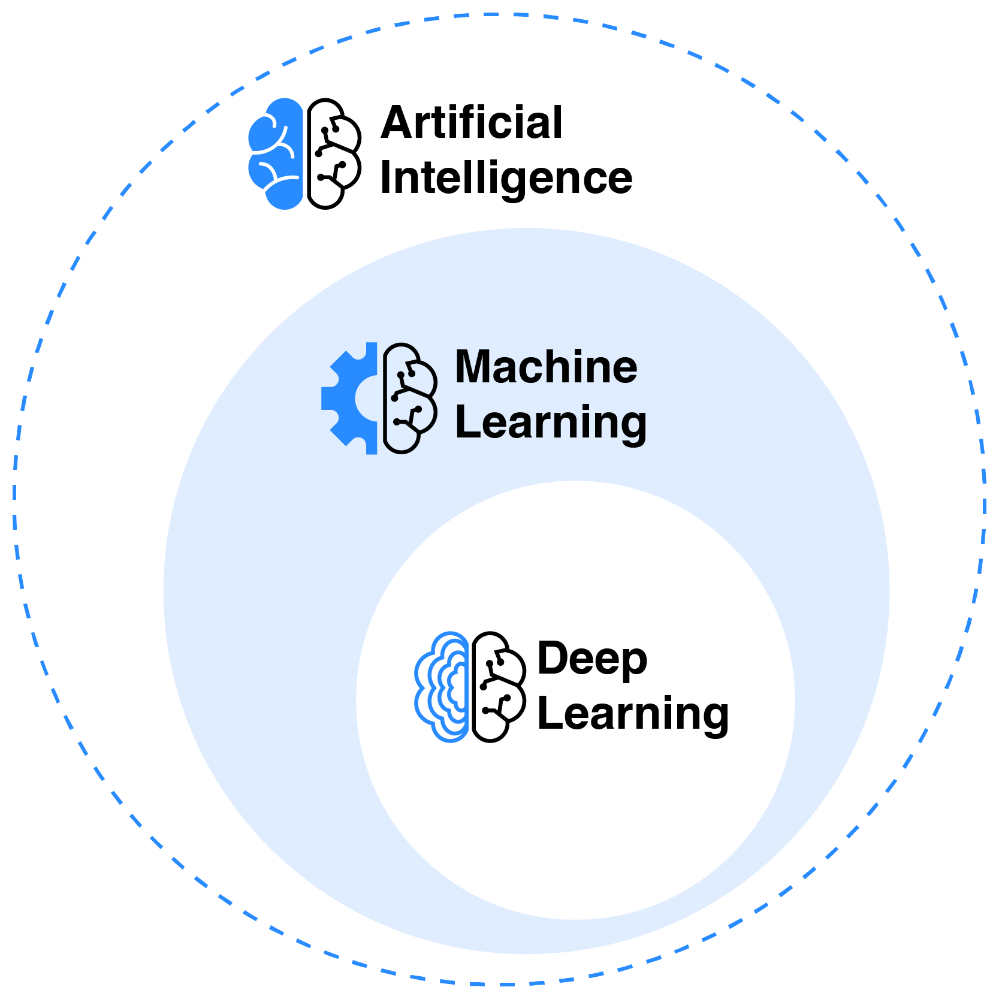

# O que é Inteligência Artificial? 

Diferente do que muitos podem pensar, a Inteligência Artificial (IA) não é uma inovação tecnológica recente. Na verdade, ela teve início em 1950 quando Alan Turing a descreveu pela primeira vez em seu artigo "Computing Machinery and Intelligence" (você pode saber mais sobre a história de sua evolução nesse [link](04-historia-da-ia.md)).

A grande novidade tecnológica recente veio com a evolução dos **modelos generativos** como o ChatGPT, Gemini, Claude entre muitos outros no mercado, mas eles são **apenas um tipo** de IA. Existe uma grande variedade de modelos, que inclusive, vêm sendo usados há muitos anos.

Muito provável que você já interaja com IA todos os dias, mesmo sem perceber! Por exemplo, quando o seu celular reconhece o seu rosto para desbloquear a tela, quando o seu e-mail filtra automaticamente as mensagens de spam ou quando você usa o aplicativo de GPS para calcular a rota mais rápida até algum endereço. A IA já faz parte do nosso cotidiano em áreas que nem imaginamos.

## Desmistificando a IA
Umas das possíveis definições para a inteligência artificial é:

> *"Um sistema artificial desenvolvido em software de computador, hardware físico ou outro contexto, que resolve tarefas que exigem percepção, cognição, planejamento, aprendizagem, comunicação ou ação física semelhantes às humanas."* —  [(traduzida) uma das definições adotadas pela NASA](https://www.nasa.gov/what-is-artificial-intelligence/).

De maneira geral, a Inteligência Artificial é um campo da ciência da computação focado em criar sistemas capazes de resolver problemas que exigiriam o intelecto humano. 

Em vez de serem programados tipo "se acontecer X, faça Y", os sistemas modernos de IA são treinados. Eles são expostos a uma enorme quantidade de dados e, a partir disso, aprendem a identificar padrões, compreender contextos e tomar decisões. Deixamos de dizer ao computador *exatamente* o que fazer e passamos a ensiná-lo *como aprender* a partir de exemplos.

## Como a Inteligência Artificial funciona?

A "mágica" por trás das respostas de uma IA é fundamentada em pura **matemática e probabilidade**. 

Quando você faz uma pergunta, o sistema calcula qual é a combinação de palavras ou ações *estatisticamente mais provável e correta* para te responder. Você pode entender mais detalhado como isso funciona nesse [link](03-como-a-ia-aprende.md).

Para que a máquina consiga processar tantas informações de "forma inteligente", desenvolveram-se algumas técnicas:

| Tecnologia | Significado | Exemplo de Aplicação |
| :---: | :---: | :---: |
| **Machine Learning (ML)** | É o aprendizado de máquina, permite o algoritmo tomar decisões e prever resultados com base nos dados fornecidos| Filtros de spam no seu e-mail |
| **Deep Learning** | Um subconjunto do aprendizado de máquina que usa redes neurais multicamadas/profundas, que simulam o cérebro humano| Sistemas de veículos autônomos |
| **Processamento de Linguagem Natural (PLN)** | Permite que os computadores entendam, interpretem e gerem linguagem humana | Assistentes de voz como Siri e Alexa |
| **Visão Computacional** | Permite que os computadores "vejam" e interpretem informações visuais do mundo, como imagens e vídeos | Reconhecimento facial |
| **Redes neurais** | Uma estrutura de processamento inspirada nos neurônios do cérebro. Utiliza cálculos matemáticos em "nós" interconectados para processar informações | A base estrutural que faz o *Deep Learning* funcionar |

Para ficar mais claro qual a diferença entre essas técnicas de aprendizado, podemos ilustrar como um conjunto. A camada mais externa é a IA propriamente dita com todas suas nuances de PLN, visão computacional e tipos e as camadas interiores sendo subconjuntos desse todo que vão tornando o aprendizado mais especializado. O Deep Learning pode ser considerado um Machine Learning mais "intenso". Você pode entender mais sobre isso nesse [link](03-como-a-ia-aprende.md).

---

## A IA Generativa

A IA generativa refere-se a modelos de *deep learning* que podem criar conteúdo gerado a partir de uma solicitação escrita pelo usuário - *prompt*. 

O motivo de ela se destacar tanto é que, enquanto a IA tradicional era usada para *analisar*, *classificar* e *prever* informações (como a previsão do tempo ou a cotação de uma moeda), a,  IA Generativa, por sua vez, atua na *co-criação* de textos, imagens, vídeos e áudios. 

Alimentada por Grandes Modelos de Linguagem (os chamados *LLMs*), ela compreende o nosso idioma quase como um humano. Com um simples prompt as ferramentas como o ChatGPT, Gemini, Claude, DeepSeak entre muitos outros conseguem traduzir artigos, compor músicas, desenhar imagens inexistentes e até resumir documentos PDF inteiros em segundos.

---
